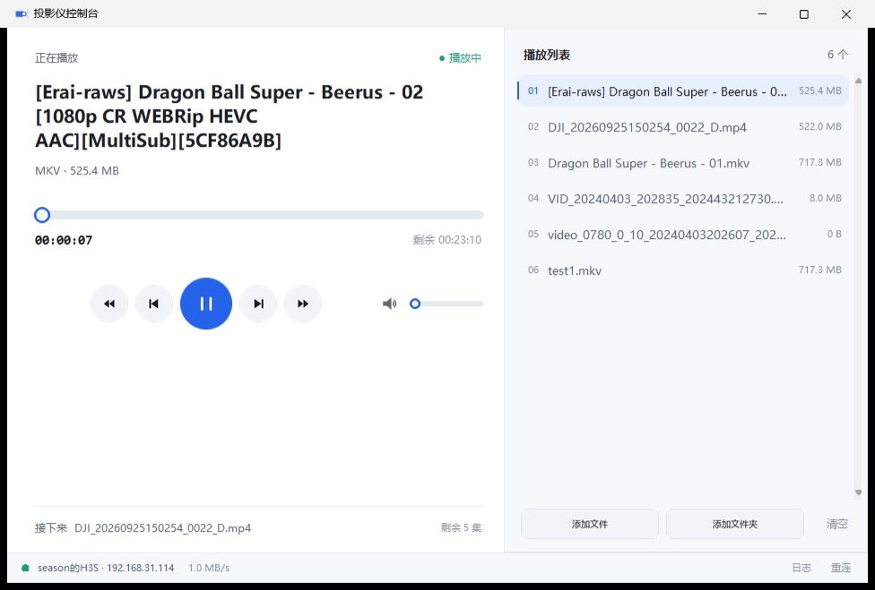

# xgimi-cast · 极米投屏控制台

Windows 桌面端的 DLNA 投屏工具：把电脑里的视频推到投影仪播放，带播放列表、进度跳转和音量控制。

最初为极米 H3S 编写，实际上任何实现了标准 DLNA/UPnP 渲染器的设备都能用。



## 功能

- **设备发现**：SSDP 自动发现局域网内的渲染器；渲染器端口是动态的，程序从广播里读取真实端口，端口变了也能自己纠正
- **播放列表**：添加文件夹（递归扫描、自然排序）、多选文件、拖动排序、单项删除、关闭后自动恢复
- **播放控制**：播放/暂停、上一集/下一集、±10 秒、点击进度条任意位置跳转
- **音量**：拖动调节、点击喇叭一键静音
- **自动续播**：一集播完自动接下一集
- **空文件过滤**：小于 1KB 的文件不会入列
- **命令行模式**：适合脚本化调用

## 环境要求

- Windows 10 / 11
- Python 3.9+
- [Pillow](https://pypi.org/project/pillow/)（界面抗锯齿渲染依赖）

## 快速开始

```bash
git clone https://github.com/ddddssss2022/xgimi-cast.git
cd xgimi-cast
pip install -r requirements.txt
python projector.py --gui
```

也可以双击 `start_gui.bat`（请先确认里面的 Python 路径与你本机一致）。

首次投屏时 Windows 防火墙可能弹窗，需要允许，否则投影仪拉不到流。

## 命令行用法

```bash
python projector.py discover                       # 扫描局域网设备
python projector.py status                         # 查看播放状态与音量
python projector.py cast "D:\video\movie.mp4" --volume 40
python projector.py pause / play / stop
python projector.py vol 50
python projector.py seek 120
```

## 工作原理

程序扮演 DLNA 控制器：通过 SOAP 调用设备的 `AVTransport` / `RenderingControl` 服务完成控制。
DLNA 是"拉模式"，所以投屏时本机会临时启动一个支持 HTTP Range 的媒体服务，由投影仪主动回读文件。

## 已知限制

- 投影仪需要开启投屏服务。极米的投屏组件关闭时，DLNA 端口会直接拒绝连接，程序会给出提示
- 不支持开关机、切换信号源、梯形校正——这些走厂商私有协议，不在 DLNA 范围内
- 暴露给播放器的文件名会被转换成纯 ASCII：部分播放器的播放链路处理不了百分号编码的路径
- mkv 等容器能否播放取决于接收端播放器，与传输层无关

## 排障

| 现象 | 排查方向 |
|---|---|
| 找不到设备 | 投影仪是否开机、是否开启了投屏服务、是否在同一网段 |
| 能连上但播放 3 秒就停 | 播放器没被唤醒，用遥控器点亮屏幕后重试 |
| 播放卡顿 | 检查 WiFi 频段，2.4GHz 实际带宽约 80Mbps，建议用 5GHz |
| 局域网内被 TUN 代理干扰 | 程序的 HTTP 请求已显式绕过系统代理 |

## License

[MIT](LICENSE)
